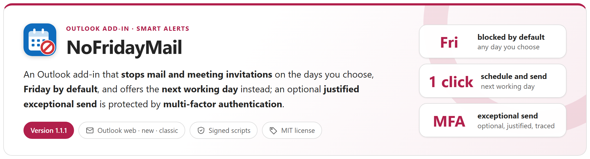
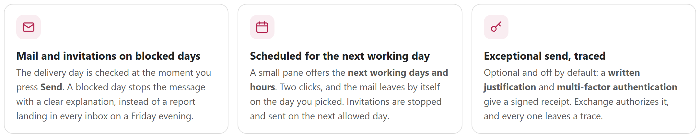
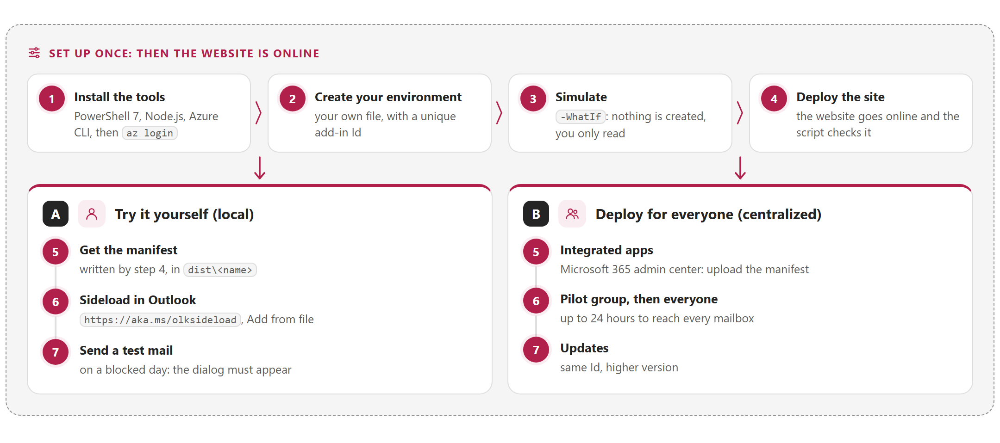
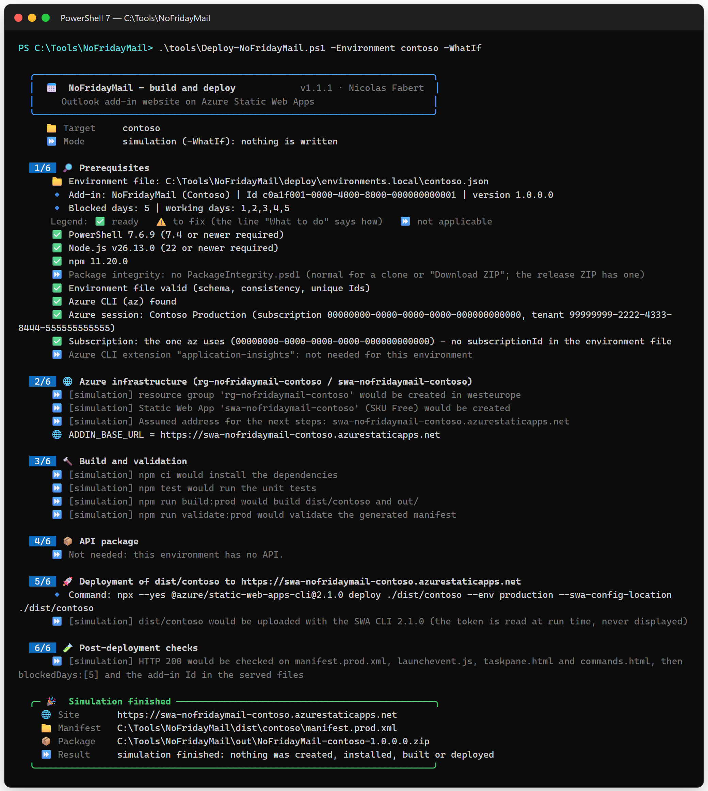
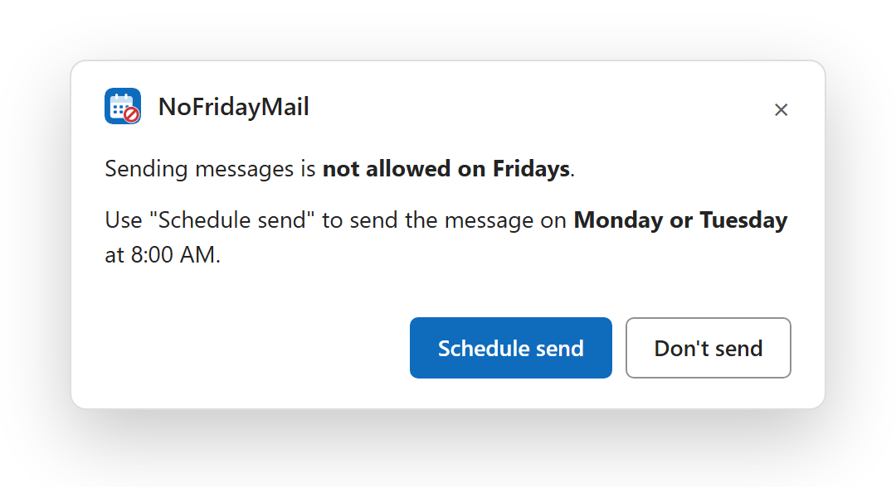
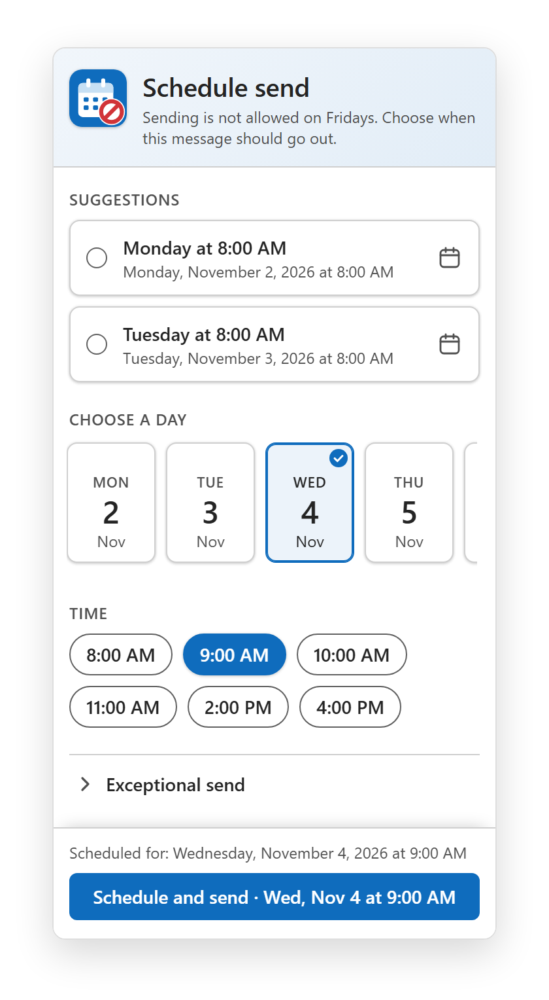
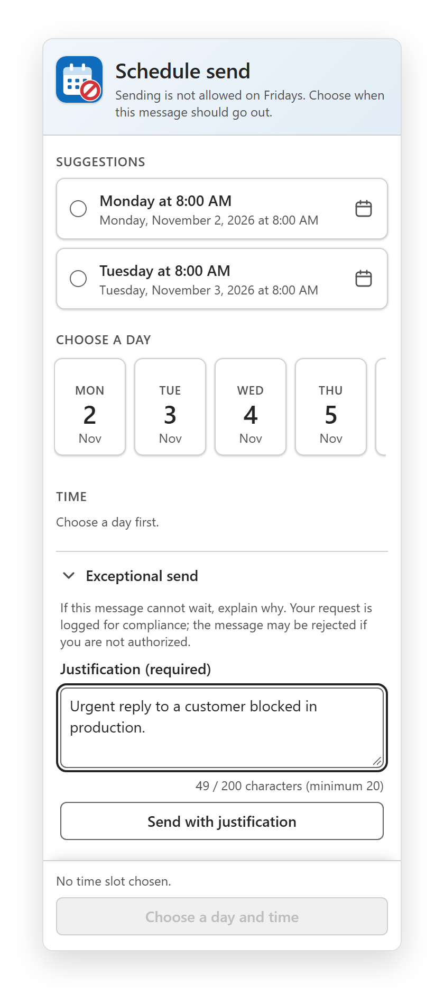

<p align="center">
  <picture>
    <source media="(prefers-color-scheme: dark)" srcset="package/docs/images/readme-banner-dark.png">
    
  </picture>
</p>

<p align="center">
  <a href="#get-started"><b>Get started</b></a> &nbsp;&middot;&nbsp;
  <a href="#how-it-works"><b>How it works</b></a> &nbsp;&middot;&nbsp;
  <a href="#exceptional-send"><b>Exceptional send</b></a> &nbsp;&middot;&nbsp;
  <a href="#reports"><b>Reports</b></a> &nbsp;&middot;&nbsp;
  <a href="#requirements"><b>Requirements</b></a> &nbsp;&middot;&nbsp;
  <a href="package/docs/NoFridayMail-UserGuide.md"><b>User guide</b></a> &nbsp;&middot;&nbsp;
  <a href="package/docs/NoFridayMail-Guide.md"><b>Developer guide</b></a>
</p>

> [!IMPORTANT]
> Files downloaded from the Internet may be blocked by Windows and fail to run. Before using this project, unblock every file in the downloaded folder:
>
> ```powershell
> Get-ChildItem "C:\Chemin\Du\Dossier" -Recurse -File -Force | Unblock-File
> ```
>
> Replace the example path with the folder where you downloaded or extracted this project.

## Why

Mail sent on the wrong day is hard to take back: a report that lands in every inbox on a Friday evening, an invitation sent before a long weekend. NoFridayMail is an Outlook add-in by Nicolas Fabert that checks the **delivery day** of every message and meeting invitation at the moment you press **Send**. On a blocked day (Friday by default, any days you choose) the send is stopped with a clear explanation, and a small pane offers the next working days and hours instead. The mail then leaves by itself, on the day you picked.

<picture>
  <source media="(prefers-color-scheme: dark)" srcset="package/docs/images/readme-why-dark.png">
  
</picture>

A delayed delivery that lands on a blocked day is stopped too, so the check cannot be bypassed with Outlook's own *Delay delivery*. The add-in speaks **French and English**, in light and dark, following the language and the theme of Outlook.

## Get started

<picture>
  <source media="(prefers-color-scheme: dark)" srcset="package/docs/images/readme-path-dark.png">
  
</picture>

One path for everyone. Set the add-in up once (**1 to 4**): it puts a small website online, in your own Azure subscription. Then take branch **A** to try the add-in on your own mailbox, with no administrator, branch **B** to give it to a group or to the whole company, or both. **A · Try it yourself** is the quick way to see the add-in work and to test your settings. **B · Deploy for everyone** is the production way: a Microsoft 365 administrator publishes the add-in once, and Outlook hands it to the people chosen.

The commands use one example — the release ZIP unpacked in `C:\Tools\NoFridayMail`, an environment named `contoso`. Copy them as they are and only change these names to yours; the [user guide](package/docs/NoFridayMail-UserGuide.md) explains each step, what you should see and what to do if not.

### Set up once · 1 to 4

```powershell
# In PowerShell 7, in the folder where you unpacked the release ZIP (unblock the files first: see the box above)
cd C:\Tools\NoFridayMail

# 1 · Install the tools, once: PowerShell 7.4 or later, Node.js 22 or later, the Azure CLI; then sign in to Azure
winget install Microsoft.PowerShell
winget install OpenJS.NodeJS.LTS
winget install Microsoft.AzureCLI
az login

# 2 · Create your environment: one small file with the Azure names and the blocked days.
#     Its add-in Id is generated once and kept for good: the same Id means Outlook updates the add-in
pwsh .\tools\New-NoFridayMailEnvironment.ps1 -Name contoso
notepad .\deploy\environments.local\contoso.json

# 3 · Simulate: shows the checklist and every step, creates nothing
pwsh .\tools\Deploy-NoFridayMail.ps1 -Environment contoso -WhatIf

# 4 · Deploy the site: creates the Azure resources if needed, builds, deploys and checks it
pwsh .\tools\Deploy-NoFridayMail.ps1 -Environment contoso
```

<details>
<summary><b>What the simulation shows</b> · six steps, a checklist of the prerequisites, and nothing created</summary>
<br>
<a href="package/docs/images/readme-console-whatif.png?raw=true"></a>
</details>

### A · Try it yourself (local) · 5 to 7

```powershell
# 5 · Get the manifest: step 4 wrote it on your disk, nothing to download. Open its folder
explorer .\dist\contoso

# 6 · Sideload it in Outlook on the web (no administrator needed): open this address, then
#     My add-ins > Custom add-ins > Add a custom add-in > Add from file, and pick manifest.prod.xml
Start-Process https://aka.ms/olksideload

# 7 · Send a test mail to yourself on a blocked day (Friday by default): the dialog must appear.
#     Not Friday today? Put today's number in blockedDays of a test environment (user guide, chapter 4)
[int](Get-Date).DayOfWeek
```

<details>
<summary><b>What you see</b> · the dialog that stops the send, then the pane where you pick the day and the time</summary>
<br>
<picture>
  <source media="(prefers-color-scheme: dark)" srcset="package/docs/images/readme-dialog-dark.png">
  
</picture>
<br><br>
<picture>
  <source media="(prefers-color-scheme: dark)" srcset="package/docs/images/readme-pane-dark.png">
  
</picture>
</details>

### B · Deploy for everyone (centralized) · 5 to 7

```powershell
# 5 · Integrated apps: as a Microsoft 365 administrator, upload the same manifest (dist\contoso\manifest.prod.xml):
#     Settings > Integrated apps > Upload custom apps > Office Add-in > Upload manifest file
Start-Process https://admin.microsoft.com

# 6 · Pilot group first (Specific users/groups), then Everyone: the add-in can take up to 24 hours to appear.
#     Ask a pilot user to close and reopen Outlook, then to repeat the test of step 7

# 7 · Updates: raise "version" in your environment file (1.0.0.0 becomes 1.0.1.0), redeploy, then upload the
#     new manifest in Integrated apps. Same add-in Id, higher version: Outlook updates the add-in
notepad .\deploy\environments.local\contoso.json
pwsh .\tools\Deploy-NoFridayMail.ps1 -Environment contoso
```

Settings only (blocked days, hours) need no new manifest: change the environment file and redeploy ([user guide, chapter 6](package/docs/NoFridayMail-UserGuide.md#6-keep-it-running)).

## How it works

<picture>
  <source media="(prefers-color-scheme: dark)" srcset="package/docs/images/readme-how-dark.png">
  
</picture>

- **A classic Outlook add-in, with Smart Alerts.** The add-in handles the *on send* events (`OnMessageSend`, `OnAppointmentSend`). The effective delivery time is the delayed delivery of the message when it is set and in the future, otherwise now, in the local time of the client. If that day is blocked, Outlook shows the add-in's dialog instead of sending.
- **Mail is rescheduled in two clicks.** Meeting invitations cannot be delayed: on a blocked day they are stopped with an explanation and can be sent on the next allowed day.
- **Rules per environment.** One JSON file per environment (`deploy/environments`) holds the add-in name, its unique Id, the version, the Azure resources and the rules: blocked days, proposed working days, the hours offered and the default language. The build injects them into the bundle and generates the manifest. Nothing else is configured.
- **A static site on Azure Static Web Apps.** The task pane, `launchevent.js` and the pages are static files. `tools/Deploy-NoFridayMail.ps1` creates the resources if needed, builds, deploys and checks the served site. It never writes the deployment token to disk or to the console, and `-WhatIf` changes nothing.
- **Installed by Microsoft 365.** For one person, sideload the generated manifest in Outlook. For everyone, upload it once in the Microsoft 365 admin center (Integrated apps) and choose the users or groups; propagation can take up to 24 hours.

## Exceptional send

An option, **off by default**: when a message cannot wait, the user writes a justification, proves their identity with multi-factor authentication through Microsoft Entra ID, and the mail carries a signed receipt that an Exchange transport rule can authorize and audit. The add-in cannot know whether the user is authorized: the managed API (`api/`) validates the Entra token and the justification and returns the receipt, and an Exchange transport rule authorizes by group and traces every message. Turn it on only after that server side is in place; see the [developer guide](package/docs/NoFridayMail-Guide.md#9-exceptional-send).

<details>
<summary><b>What the user sees</b> · the "Exceptional send" section of the pane, under the scheduling</summary>
<br>
<picture>
  <source media="(prefers-color-scheme: dark)" srcset="package/docs/images/readme-pane-bypass-dark.png">
  
</picture>
</details>

## Reports

Every exceptional send leaves traces in four places, from the request to the message. Nothing is kept by the add-in itself.

| Where | What you find |
|---|---|
| Application Insights | One `NFM_BYPASS` line per accepted request and `NFM_BYPASS_DENIED` per refusal: who, when, the justification, the token identifier (never the token) |
| Microsoft Entra sign-in logs | The multi-factor sign-in behind the receipt, joined with the API line by the token identifier |
| Exchange message trace | The message and the transport rule that authorized it |
| Microsoft Purview DLP | One alert or incident report line per message carrying the header |

A receipt can also be verified offline with `tools/verify-receipt.js`. The queries, the five-minute freshness window and the rule are in the [developer guide](package/docs/NoFridayMail-Guide.md).

## Limits

- **Outlook on Android and iOS is not covered.** Smart Alerts is not supported there: a message sent from a phone is not checked.
- **Smart Alerts is a safeguard, not a security boundary.** In `SoftBlock` mode, if the add-in cannot load, Outlook lets the message go. For a hard guarantee, add an Exchange transport rule ([developer guide](package/docs/NoFridayMail-Guide.md)).
- Public holidays are not handled: only the day of the week is checked. The time zone is the one of the client, not the recipient's.

## Requirements

| Item | Requirement |
|---|---|
| Outlook | Outlook on the web, new Outlook for Windows, classic Outlook for Windows (2206 or later, 2412 for the custom *Schedule send* button), Outlook for Mac (new interface). Mailbox requirement set 1.12 or later |
| Microsoft 365 | Exchange Online mailboxes. Smart Alerts add-ins run only when deployed by an administrator or sideloaded for a test: the *Global Administrator* or *Exchange Administrator* role to publish the manifest |
| PowerShell | 7.4 or later, to run the deploy script |
| Node.js | 22 or later with npm (the build uses webpack; the managed API runs on Node 22) |
| Azure | Azure CLI signed in (`az login`) and a subscription where you can create a resource group and a Static Web App (*Contributor*); the `Microsoft.Web` provider registered. The Free plan is enough |
| Optional exceptional send | A Microsoft Entra app registration, a Conditional Access authentication context requiring MFA every time, an Exchange transport rule and, for traces, Application Insights |

## Quick start

The same path in five commands, for readers who already know PowerShell and Azure. [Get started](#get-started) above explains each step, with what you should see.

```powershell
cd C:\Tools\NoFridayMail                                        # the unpacked release ZIP
az login
pwsh .\tools\New-NoFridayMailEnvironment.ps1 -Name contoso      # your environment, with its own add-in Id
pwsh .\tools\Deploy-NoFridayMail.ps1 -Environment contoso -WhatIf
pwsh .\tools\Deploy-NoFridayMail.ps1 -Environment contoso       # then install dist\contoso\manifest.prod.xml
```

The release ZIP is the recommended download: it holds exactly what is needed to deploy and use the add-in, with an integrity manifest. On a blocked day, send a test message: the add-in dialog must appear. The user guide has the checks and a troubleshooting table.

## Documentation

The `package` folder of this repository holds exactly the files needed to deploy and use the add-in, with both guides; the release ZIP is that folder with its integrity manifest, and "Download ZIP" gives that folder alone. The guides are Markdown and one HTML file each, with a light and a dark theme.

| Guide | Content |
|---|---|
| **[User guide](package/docs/NoFridayMail-UserGuide.md)** ([HTML](package/docs/NoFridayMail-UserGuide.html)) | **The guided path**, step by step: set up once (**1 to 4**), then **A · Try it yourself** (one person, local) or **B · Deploy for everyone** (centralized). Each step gives the command to copy, what you should see and what to do if not; then how to keep it running and how to change the settings. |
| **[Developer guide](package/docs/NoFridayMail-Guide.md)** ([HTML](package/docs/NoFridayMail-Guide.html)) | Everything else: how the rules work, every setting of an environment, the exceptional send and its server side, deployment operations, troubleshooting, how to modify and validate the project. |

See also [CHANGELOG.md](CHANGELOG.md) and the [package readme](package/README.md), the short readme of what you download.

## Tests

```powershell
cd package; npm ci; cd ..        # the product's dependencies (the tests reuse them)
npm ci                            # the development tools (icons)
npm test                          # unit tests (node --test), no Outlook, Azure or Exchange needed
cd package
npm run build                     # bundle and production manifest
npm run validate:env              # schema and consistency of the environment files
cd ..
Invoke-Pester -Path .	ests       # deploy script and package integrity (Pester 5 or later)
```

The tests, the continuous integration and the development tools live at the root of the repository, outside `package`: they are not part of the release ZIP or of "Download ZIP". GitHub Actions runs them on a disposable Windows runner, without Azure, Exchange, secrets or a signing certificate. `tests/public-safety.test.js` fails if a tenant, subscription or application identifier or a laboratory host name reaches the repository. `npm run images` (repository root) renders the images of this page again, in light and dark, from the guides and from the real task pane.

## Data handling

The add-in reads only the delivery time of the item being sent and the clock; it does not read message content or recipients and stores nothing. With the exceptional send enabled, the justification and the identity of the user go to the managed API of your own Azure Static Web App, which logs them to your Application Insights. Nothing is sent to the author. The hosted files are static: serve them over HTTPS only, and protect the deployment token and who can change `main`.

The release ZIP carries `PackageIntegrity.psd1`, the SHA-256 of every file, and the deploy script checks it before running when it is present. Releases are signed by the owner with Authenticode; a package built by CI is unsigned and is not for deployment. Obtain releases only from the official repository.

## License

[MIT](LICENSE). The npm packages bundled in the site and the API keep their own licenses: see [THIRD-PARTY-NOTICES.md](package/THIRD-PARTY-NOTICES.md). To report a vulnerability, see [SECURITY.md](SECURITY.md).

## Disclaimer

This Script is a Personal project.
It's provided "AS-IS". It's not an official Microsoft product so no support can be expected from Microsoft.

As any scripts you must read carefully the documentation and test it first in a Test environment before any run in Production.

NoFridayMail does not cover Outlook on Android and iOS, and in `SoftBlock` mode Outlook lets a message go when the add-in cannot load: it is a safeguard against accidental sends, not a guarantee. Use an Exchange transport rule if a hard guarantee is required.
